# Database

PostgreSQL 16, normalized to 3NF. Tenant anchor is `organizations`.

```mermaid
erDiagram
  organizations ||--o{ users : has
  organizations ||--o{ projects : owns
  organizations ||--o{ invoices : billed
  users }o--o{ roles_permissions : "user_roles"
  projects ||--o{ deliverables : contains
  projects ||--o{ invoices : "optional"
  deliverables ||--o{ document_assets : versions
  users ||--o{ audit_logs : writes
```

| Table | Key columns | Indexes |
|---|---|---|
| organizations | org_id, name, custom_domain, brand_config (JSONB), is_agency | UNIQUE(custom_domain) |
| users | user_id, org_id, email, full_name, password_hash, status, mfa_enabled | UNIQUE(email), (org_id, email) |
| roles_permissions | role_id, role_name, permissions (JSONB) | UNIQUE(role_name) |
| user_roles | user_id, role_id | composite PK |
| projects | project_id, org_id, title, status, budget, start_date | (org_id, status) |
| deliverables | deliverable_id, project_id, title, approval_status, feedback, due_date | (project_id, approval_status) |
| document_assets | asset_id, deliverable_id, file_path, file_name, file_size, version, visibility | (deliverable_id) |
| invoices | invoice_id, org_id, project_id, amount, status, due_date | (org_id, status) |
| audit_logs | log_id, user_id, action, ip_address, timestamp | (timestamp, user_id) |

Differences from the PDF: added `is_agency` (to tell staff orgs from client orgs), `full_name`, `feedback`, `file_name`, `visibility`; `ip_address` is `varchar` instead of `INET`; `audit_logs` is append-only by convention, not yet enforced by a DB rule.

Connect locally: `psql -h localhost -U saiam saiam` (password `saiam`).
